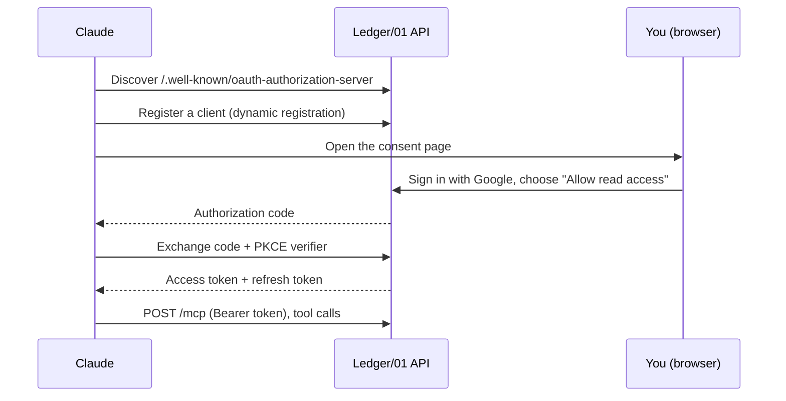

[← README](../README.md) · [Features](features.md) · [Getting started](getting-started.md) · [Your data](your-data.md) · **AI assistants** · [Self-hosting](self-hosting.md) · [Architecture](architecture.md) · [Development](development.md)

# AI assistants

Ask Claude about your own money. It reads your ledger and never changes it.

**On this page:** [Connect Claude](#connect-claude) · [What you can ask](#what-you-can-ask) ·
[Tools](#tools) · [Privacy and access](#privacy-and-access) · [How sign-in works](#how-sign-in-works)

## Connect Claude

Ledger/01 is an [MCP](https://modelcontextprotocol.io) server, so Claude, or any MCP client, can
answer questions from your data.

1. In Claude, add a **custom connector** with your deployment's address plus `/mcp`, for example
   `https://<id>.cloudfront.net/mcp`. Locally it's `http://localhost:3000/mcp`.
2. Claude sends you to Ledger/01. Sign in with Google and choose **Allow read access**.
3. Ask away.

There is nothing extra to deploy or configure: the same API that serves the app serves MCP.

## What you can ask

- "Am I spending more on takeout than last month?"
- "What are my biggest categories this quarter?"
- "How are my budgets doing this month?"
- "Which bills are coming up in the next two weeks?"
- "Find everything I paid at Luna Pizza this year."

## Tools

Claude sees these read-only tools:

| Tool                  | What it returns                                                                                       |
| --------------------- | ----------------------------------------------------------------------------------------------------- |
| `get_profile`         | Your name, household and base currency                                                                |
| `list_wallets`        | Wallets with their currencies and balances                                                            |
| `list_categories`     | Categories, to map names to ids                                                                       |
| `list_labels`         | Labels                                                                                                |
| `search_transactions` | Transactions in a date range, filtered by note, category, label, wallet, kind or amount               |
| `spending_summary`    | Income, expenses and balance for a period in the base currency, by day, week or month and by category |
| `category_report`     | One category over a period: total, count, average, busiest weekday, latest transactions               |
| `budget_status`       | Every budget's spending this period, or one budget's history                                          |
| `list_upcoming`       | Recurring transactions dated after today, soonest first                                               |

As in the app, "today" comes from the client: upcoming rows never count in totals.

## Privacy and access

- **Read-only.** No tool can create, edit or delete anything.
- **Your household only.** Every tool call is scoped to the household of the account that approved
  it.
- **You can revoke it any time.** **Settings → Connected apps** lists every connected app and
  disconnects it.
- **Your server.** Claude talks to your deployment directly; no third-party service sits in between.

## How sign-in works

The API is its own OAuth 2.1 server, with dynamic client registration, PKCE and rotating refresh
tokens.

---

[← Your data](your-data.md) · Next: [Self-hosting →](self-hosting.md)
