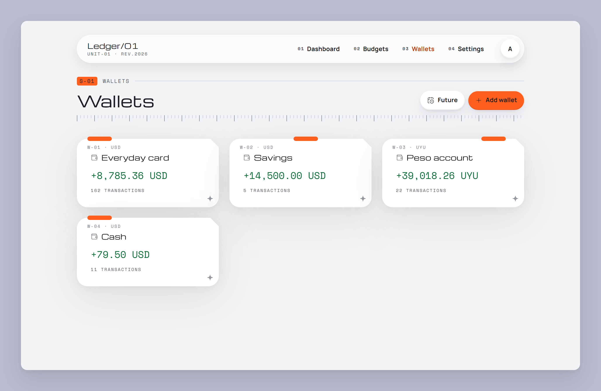
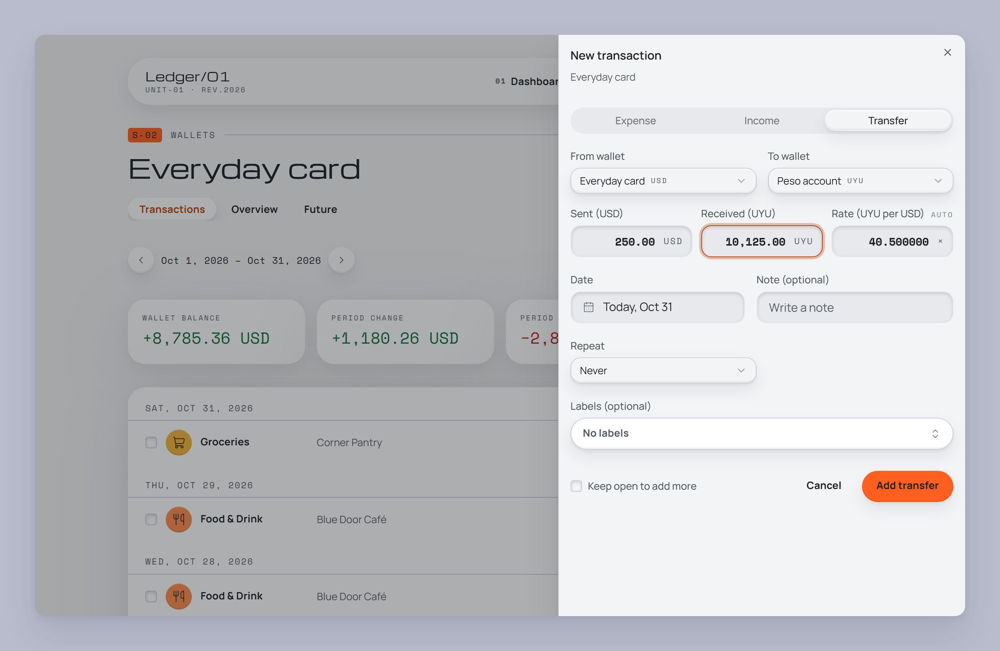
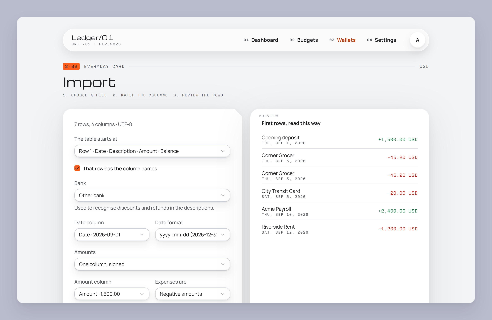
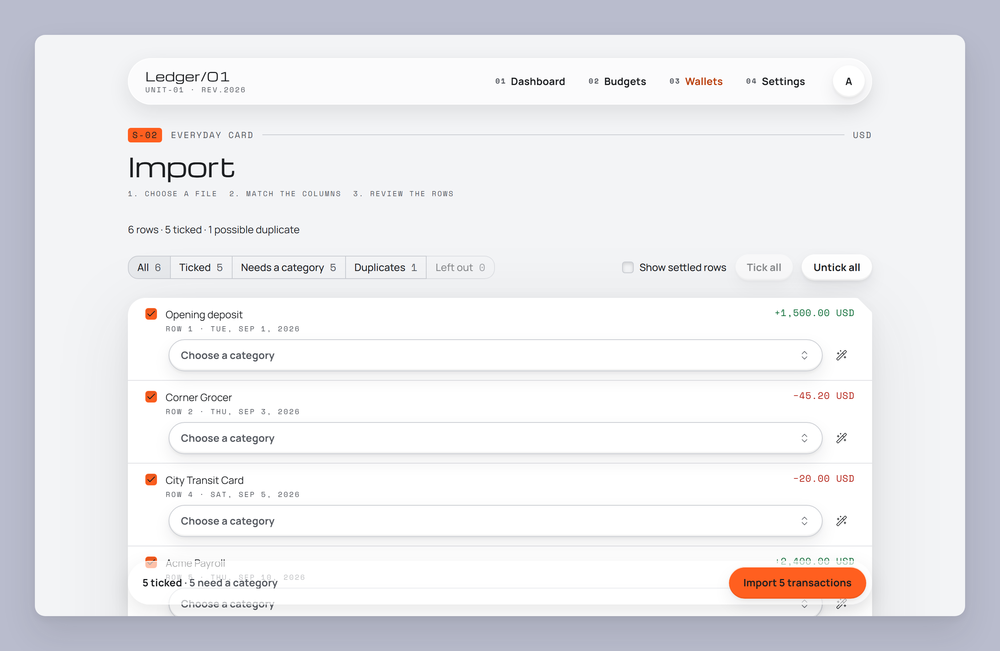
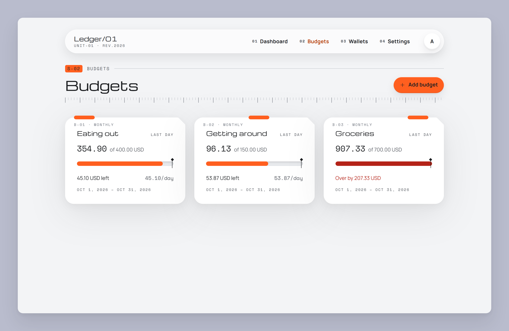

[← README](../README.md) · [Features](features.md) · **Getting started** · [Your data](your-data.md) · [AI assistants](ai-assistants.md) · [Self-hosting](self-hosting.md) · [Architecture](architecture.md) · [Development](development.md)

# Getting started

Run Ledger/01 on your machine in about five minutes, then set up your first wallets.

**On this page:** [Run it locally](#run-it-locally) · [Sign in](#sign-in) ·
[Add your wallets](#1-add-your-wallets) · [Record a transaction](#2-record-a-transaction) ·
[Import a statement](#3-import-a-statement) · [Set a budget](#4-set-a-budget) ·
[Install it on your phone](#5-install-it-on-your-phone) · [Next steps](#next-steps)

## Run it locally

You need [Go](https://go.dev/dl/), [Bun](https://bun.sh), [Node.js LTS](https://nodejs.org),
[Docker](https://www.docker.com/products/docker-desktop/) and [Task](https://taskfile.dev).
[Local development](development.md#prerequisites) has the details.

```bash
cp .env.example .env
task setup
task db:up
task migrate
task dev
```

Open <http://localhost:3000>.

> [!TIP]
> On a fresh Ubuntu or Debian machine, `bash setup.sh` installs the toolchain, starts Postgres,
> writes a development `.env` and applies migrations in one go. `START=1 bash setup.sh` also starts
> the app.

## Sign in

Two ways to sign in:

- **Google**, the way the deployed app works. Create an OAuth client and list your account in
  `ALLOWED_EMAILS`. [Local development](development.md#google-sign-in) has the steps.
- **Dev login**, to try it without Google. Set `AUTH_DEV_LOGIN=1` in `.env` (development only) and
  sign in with any address listed in `ALLOWED_EMAILS`. See
  [Local development](development.md#dev-login).

Your household is created the first time you sign in, with a starter set of categories.

## 1. Add your wallets

Go to **Wallets → Add wallet** and add one wallet per account, card or cash pile. Give each one a
name, a currency and the balance it has today.



## 2. Record a transaction

Open a wallet and choose **New transaction**. Pick **Expense**, **Income** or **Transfer**. Fill in
the category, amount, date and an optional note and labels. To make it repeat, set **Repeat**: rent
on the 3rd of every month, for example.

A transfer to a wallet in another currency asks for any two of sent, received and rate:



## 3. Import a statement

Rather than typing months of history, import your bank's statement. In a wallet, choose **Import**,
or drop the file anywhere on the page.

1. **Choose a file:** CSV, XLSX or XLS.
2. **Match the columns:** date, amount and description are guessed from the headers, and you can fix
   them. Ledger/01 remembers the mapping for next time.
3. **Review the rows:** pick categories, tick or untick rows, and turn a row into a rule ("when the
   note contains _City Transit_, use _Transport_").





[Your data](your-data.md#import-bank-statements) covers duplicates, refunds and adding your bank.

## 4. Set a budget

Go to **Budgets → Add budget**. Choose the categories and wallets it covers, an amount, and how often
it repeats. The card shows how much is left and a daily allowance for the rest of the period.



## 5. Install it on your phone

Open the app in your phone's browser and use **Add to Home Screen** (Safari) or **Install app**
(Chrome). It then opens full-screen, like any other app.

> [!NOTE]
> Phones can't reach `localhost` on your computer. To use Ledger/01 from your phone,
> [deploy it](self-hosting.md) first.

## Next steps

- [Deploy it to your own AWS account](self-hosting.md), so it's there from every device.
- [Connect Claude](ai-assistants.md) and ask questions about your spending.
- [Move your data](your-data.md#moving-from-local-to-aws) from your local setup to the deployment.

---

[← Features](features.md) · Next: [Your data →](your-data.md)
