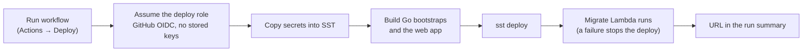

[← README](../README.md) · [Features](features.md) · [Getting started](getting-started.md) · [Your data](your-data.md) · [AI assistants](ai-assistants.md) · **Self-hosting** · [Architecture](architecture.md) · [Development](development.md)

# Self-hosting on AWS

Deploy Ledger/01 to your own AWS account from GitHub Actions. You own the servers, the database and
the bill, and the bill is close to zero.

**On this page:** [What you get](#what-you-get) · [How a deploy works](#how-a-deploy-works) ·
[One-time setup](#one-time-setup) · [Deploying](#deploying) · [Upgrading](#upgrading) ·
[Security notes](#security-notes)

## What you get

Ledger/01 deploys with [SST](https://sst.dev):

- the Go API runs on Lambda behind API Gateway;
- Next.js runs on Lambda through OpenNext;
- a CloudFront router sits in front of both;
- an EventBridge schedule runs the daily jobs.

Postgres lives outside AWS. [Neon](https://neon.com) fits well: it scales to zero, has a built-in
connection pooler, and its free plan covers a household. [Architecture](architecture.md) has the full
map and a [cost breakdown](architecture.md#what-it-costs).

## How a deploy works



Deploys run from GitHub Actions. OpenNext doesn't support Windows. On macOS, Linux or WSL you can also
run `bun x sst deploy --stage production` yourself after setting the same SST secrets.

## One-time setup

1. **Database.** Create a Neon project in the region you deploy to: `sa-east-1` (São Paulo) by
   default, or set the `AWS_REGION` repository variable. Copy the **pooled** connection string (the
   host contains `-pooler`). Migrations switch to the direct host by themselves.
2. **Google sign-in.** Create an OAuth client (type **Web application**). The redirect URI comes
   after the first deploy.
3. **AWS role.** Open CloudFormation in the AWS console, choose **Create stack**, and upload
   [infra/github-deploy-role.yml](../infra/github-deploy-role.yml). Set `GitHubSubjectPrefix` to the
   subject prefix in your fork's OIDC tokens, which this prints:

   ```bash
   gh api repos/OWNER/NAME/actions/oidc/customization/sub --jq .sub_claim_prefix
   ```

   Newer repositories include their owner and repository IDs, as in
   `repo:your-name@1234/ledger-01@5678`. If it prints nothing or `null`, use `repo:OWNER/NAME`.
   AWS compares it case-sensitively. If your account already trusts GitHub, set
   `CreateOIDCProvider` to `false`. Copy the `RoleArn` output.
4. **GitHub.** In the repository settings:
   - **Variables:** set `AWS_DEPLOY_ROLE_ARN` to the role ARN. Also set `AWS_REGION` if you don't use
     `sa-east-1`.
   - **Environments:** create `production` with these secrets:

     | Secret                 | Value                                      |
     | ---------------------- | ------------------------------------------ |
     | `DATABASE_URL`         | Neon's pooled connection string            |
     | `GOOGLE_CLIENT_ID`     | From the OAuth client                      |
     | `GOOGLE_CLIENT_SECRET` | From the OAuth client                      |
     | `ALLOWED_EMAILS`       | Comma-separated Google accounts allowed in |

     Under **Deployment branches**, allow only `main`, and protect `main` so changes go through a PR.

> [!IMPORTANT]
> Restrict the `production` environment to `main`. Otherwise anyone with write access could run an
> edited workflow from another branch with the role and these secrets.

## Deploying

Go to **Actions**, open **Deploy**, and choose **Run workflow**. The run:

1. copies the secrets into SST;
2. builds the Go `bootstrap` binaries and the web app;
3. applies migrations (a failing migration stops the deploy);
4. shows the URL in its summary.

After the first deploy, add `https://<id>.cloudfront.net/auth/google/callback` to the OAuth client's
authorized redirect URIs.

The `production` stage is protected from `sst remove` and keeps its resources if removed.

## Upgrading

Pull the new release into your fork and run **Deploy** again. Releases follow semantic versioning:

| Release | What upgrading takes                                                                                          |
| ------- | ------------------------------------------------------------------------------------------------------------- |
| Patch   | A redeploy. Fixes only.                                                                                       |
| Minor   | A redeploy. New features.                                                                                     |
| Major   | Manual steps, listed in the release notes: a new secret, a migration that needs help, or a deployment change. |

Each release's notes are on the [Releases page](https://github.com/franco-roura/ledger-01/releases).

## Security notes

- The role ARN, the variables and the secrets are never copied to forks.
- Only jobs running in your repository's `production` environment can assume the role.
- On a public repository the workflow logs are public. Secrets are masked, and so is the AWS account
  ID (`mask-aws-account-id`). SST's output still shows the app's CloudFront and API Gateway URLs.
- Sessions live in Postgres, and the API reads its configuration only from environment variables.

---

[← AI assistants](ai-assistants.md) · Next: [Architecture →](architecture.md)
