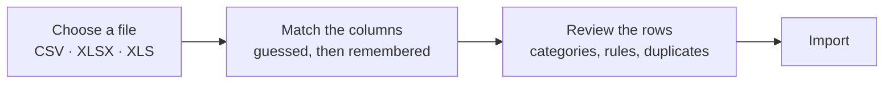
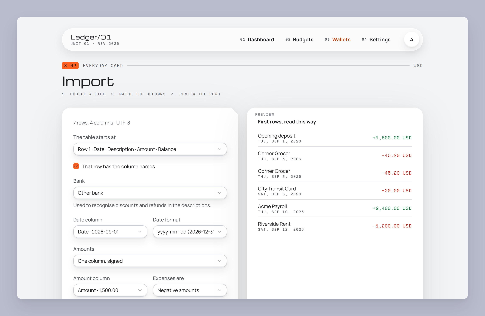
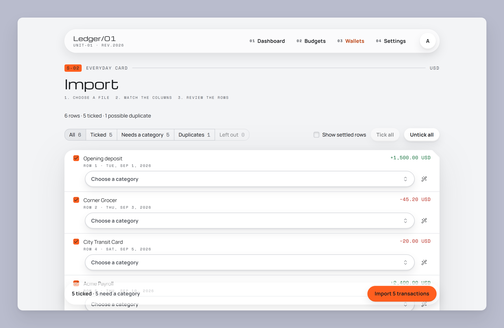
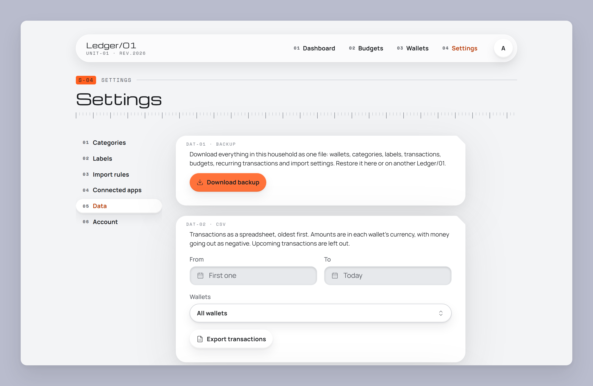

[← README](../README.md) · [Features](features.md) · [Getting started](getting-started.md) · **Your data** · [AI assistants](ai-assistants.md) · [Self-hosting](self-hosting.md) · [Architecture](architecture.md) · [Development](development.md)

# Your data

How data gets into Ledger/01 and back out of it. It lives in your database, and one file moves it
anywhere.

**On this page:** [Import bank statements](#import-bank-statements) ·
[Discounts and refunds](#discounts-and-refunds) · [Supported banks](#supported-banks) ·
[Backups](#backups) · [Moving from local to AWS](#moving-from-local-to-aws) ·
[CSV export](#csv-export) · [Where your data lives](#where-your-data-lives)

## Import bank statements

Bank statements in **CSV, XLSX or XLS** import into any wallet. Open the wallet and choose **Import**,
or drop the file anywhere on the page. Statements with bank details above the table work too: the
import starts at the header row.

At the review step:

- **Duplicates** start unticked. A row that matches one you imported before, even from a renamed
  file, is flagged as a possible duplicate.
- **Categories** come from your rules. Turn any row into a rule ("when the note contains …, use …")
  and it applies to every matching row, now and in later imports. Rules are listed under
  **Settings → Import rules**.
- **Filters** show all rows, ticked rows, rows that need a category, duplicates or rows left out.

## Discounts and refunds

Ledger/01 recognises discounts and refunds and counts them against the purchase they belong to:

- a VAT refund is merged into its purchase, so the purchase shows what you actually paid;
- a double charge and its refund both start unticked, so neither inflates your spending.

To do this it needs to know how your bank words these lines.

## Supported banks

| Country | Bank |
| ------- | ---- |
| Uruguay | Itaú |

**Your bank isn't listed? Please add it.** A bank is one small Go file with a few patterns and a test,
and pull requests are welcome. [CONTRIBUTING.md](../CONTRIBUTING.md#adding-your-bank) walks you
through it.

> [!NOTE]
> Every bank imports fine without a definition. The definition only adds discount and refund
> matching.

## Backups

**Settings → Data** downloads the household's whole ledger as one gzipped JSON file.

| In a backup                                                                                   | Not in a backup                |
| --------------------------------------------------------------------------------------------- | ------------------------------ |
| Wallets, categories, labels                                                                   | Accounts and sign-in sessions  |
| Transactions, transfers, recurring transactions                                               | Connected apps (AI assistants) |
| Budgets                                                                                       |                                |
| Import settings: column mappings, rules, and the fingerprints that spot already-imported rows |                                |

**Restoring** a backup **replaces** everything in the household with the file's contents. It happens
in one database transaction, after you confirm, and the file is previewed before anything changes.
A backup restores on the same version of Ledger/01 or a newer one. Files can be up to 5 MB, which is
tens of thousands of transactions.

## Moving from local to AWS

Backups work across instances, so this is also how you move:

1. On your local setup, go to **Settings → Data → Download backup**.
2. Sign in on your deployment.
3. Go to **Settings → Data** there and restore the file.

## CSV export

The same page exports transactions as CSV: UTF-8, and it opens in Excel. You can limit it to a date
range and to some wallets. Amounts are signed decimals in each wallet's currency.

## Where your data lives

- **In your Postgres**: local Docker in development, or your own [Neon](https://neon.com) project
  when deployed. Nobody else hosts a copy.
- **Money is stored exactly**, as integer minor units plus an ISO 4217 currency code, never as
  floating point. Transfer rates are exact decimals.
- **Every row belongs to a household**, and every query is scoped to the signed-in person's
  household.

---

[← Getting started](getting-started.md) · Next: [AI assistants →](ai-assistants.md)
